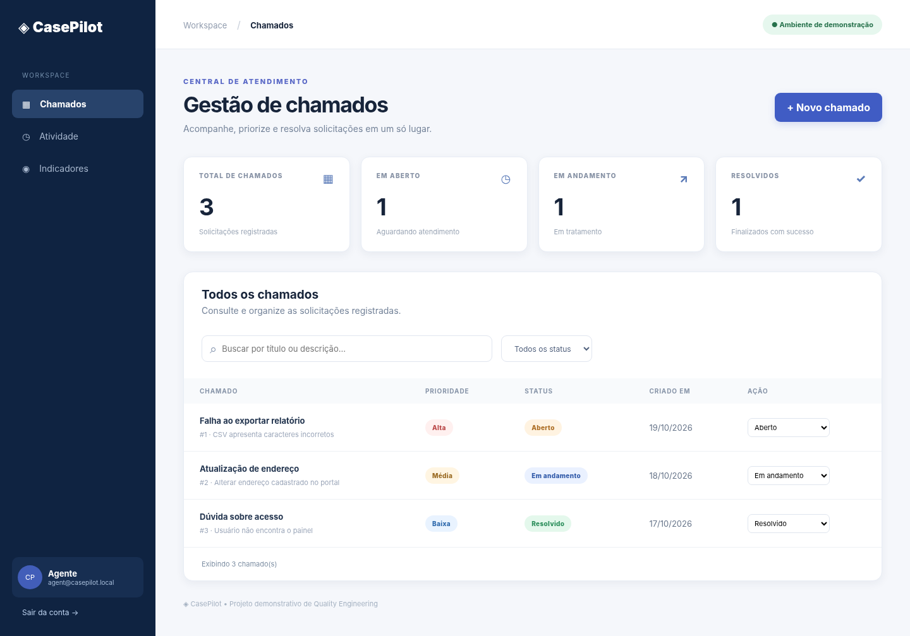

# ◈ CasePilot — UI Quality Engineering | Java + Selenium

   

**Qualidade de software aplicada a um sistema demonstrável, não apenas scripts isolados.**

Automação ponta a ponta de uma central fictícia de chamados. Inclui **aplicação web própria**, API REST, autenticação e papéis, massa de dados de demonstração, testes backend e suíte **Java + Selenium + JUnit 5**, Page Object Model, screenshots em falhas e pipeline GitHub Actions.



*Prévia do layout renderizado com dados de exemplo; não substitui a execução do teste Selenium.*

## Por que este projeto importa para QA?

Jornadas reais (login → consulta → criação → filtro → atualização → logout), autorização de papéis e evidências de falha. O objetivo é demonstrar **desenho de casos de teste, automação sustentável, engenharia de teste e rastreabilidade**.

## Stack e arquitetura

| Camada | Stack |
|---|---|
| SUT (sistema testado) | Python, FastAPI, SQLite, JS/HTML/CSS |
| Automação UI | Java 17, Selenium 4, JUnit 5, Maven |
| Testes backend | pytest, FastAPI TestClient, httpx |
| Entrega | Docker Compose, GitHub Actions, relatórios Surefire/JUnit XML |

```
app/                  # API e interface web
  main.py
  static/              # HTML, CSS, JS (sem build frontend)
automation/            # Suite Java Selenium (POM)
  pom.xml
  src/test/java/.../
    pages/             # LoginPage, TicketsPage, BasePage
    support/           # Selenium fixture, screenshot em falha
    tests/             # 9 cenários E2E
tests/backend/         # 10 cenários pytest
.github/workflows/     # QA no push e pull_request
docs/                 # estratégia, checklist e screenshot
```

## Executar no Windows (PowerShell)

**Pré-requisitos:** Python 3.11+, Java JDK 17+, Maven 3.9+, Google Chrome e Git. A primeira execução Selenium pode baixar o ChromeDriver via Selenium Manager.

Terminal 1, na raiz do projeto:

```powershell
py -m venv .venv
.\.venv\Scripts\Activate.ps1
pip install -r requirements-dev.txt
python -m uvicorn app.main:app --host 127.0.0.1 --port 8000
```

Abra **http://localhost:8000**. Para login, use `agent@casepilot.local` ou `viewer@casepilot.local`, senha `demo1234`. Exclusivamente para testes locais!

Terminal 2:

```powershell
# Backend: contratos e regras de negócio
.\.venv\Scripts\python.exe -m pytest -q tests/backend
# E2E: os testes exigem o app do terminal 1
cd automation
mvn clean test -Dheadless=true -DbaseUrl=http://localhost:8000
```

Ou execute apenas a aplicação com Docker, na raiz: `docker compose up --build`.

**Relatórios:** `automation/target/surefire-reports/`; screenshots de falhas: `automation/target/evidence/`; evidências da CI ficam disponíveis nos artefatos do job.

## O que é testado

- Credenciais corretas/incorretas e encerramento de sessão.
- Registro de chamado com prioridade e validação de campos.
- Busca e filtro por status, mudança de status via agente.
- Restrições da interface para perfil visualizador + **403** no servidor.
- API com dados isolados por execução e cenários negativos.

Plano expandido: [Estratégia](docs/TEST_STRATEGY.md) · [Checklist exploratório](docs/EXPLORATORY.md).

## GitHub Actions

`qa-ci.yml`: instala Python/Java, executa pytest, inicia a aplicação em banco separado, executa Selenium em Chrome headless e publica os relatórios de testes, inclusive em falhas. Os E2E são executáveis na CI; **o resultado efetivo deve ser conferido na aba Actions após o push**.

## Como publicar

```powershell
git init
git add .
git commit -m "feat: add casepilot selenium QA portfolio"
git branch -M main
gh repo create casepilot-qa-web --public --source=. --remote=origin --push
```

Alternativa sem GitHub CLI: crie um repositório vazio no github.com, depois `git remote add origin https://github.com/SEU_USUARIO/casepilot-qa-web.git` e `git push -u origin main`.

## Melhorias futuras

- Cobertura de acessibilidade com axe-core, testes cross-browser e paralelismo seguro.
- Auditoria de alterações de chamados e paginação no backend.
- Ambiente de staging efêmero e relatórios Allure.

## Texto curto para currículo / LinkedIn

> **CasePilot — UI Test Automation (Java, Selenium, JUnit 5)**: desenvolvi uma suíte E2E com Page Object Model para aplicação de chamados, cobrindo autenticação, papéis, criação e atualização de chamados e filtros, com testes de API auxiliares, screenshots em falhas e GitHub Actions.

**Aviso:** sistema e dados são fictícios; não utilize as credenciais de demonstração em produção. Veja [LICENSE](LICENSE).
